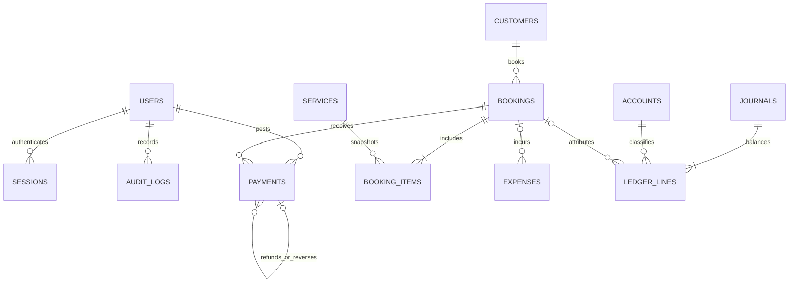

# SalonOS architecture

## Release boundary

One cumulative modular monolith: Next.js App Router, React, strict TypeScript, Tailwind CSS plus a shared visual system, Recharts, Zod, Drizzle ORM, and PostgreSQL. The first release implements the essential operational modules; later stages extend this same schema and source tree.

The requested stack is preserved with a mature type-safe ORM (Drizzle). PGlite is an optional PostgreSQL engine for local demos and tests. The standard `pg` driver is used for deployment. No business records or sessions are stored in localStorage. No bank, payment gateway, messaging or email integration is required.

## Source map

| Path                       | Responsibility                                                      |
| -------------------------- | ------------------------------------------------------------------- |
| `src/app`                  | Routes, protected workspace layout, login, API entry points         |
| `src/components`           | Workspace shell, forms, charts, data tables, operational screens    |
| `src/server/operations.ts` | Validated, authorized, transactional business commands              |
| `src/server/auth.ts`       | Scrypt credentials, opaque sessions, login rate limiting            |
| `src/server/queries.ts`    | Consistent database snapshot for authorized reads                   |
| `src/server/http.ts`       | Origin protection, bounded JSON, safe error responses               |
| `src/lib/domain.ts`        | Integer money, exact allocation, balance and date rules             |
| `src/lib/reporting.ts`     | Shared deterministic reporting based on stored records              |
| `src/db/schema.ts`         | Typed relational schema                                             |
| `migrations`               | Versioned PostgreSQL schema and integrity constraints               |
| `scripts`                  | Migrations, seed, user provisioning, verification and demo commands |
| `tests`                    | Unit and database workflow integration tests                        |

## Current relationships

All operational records have UUID identifiers and stable unique display codes. Parent deletions are restricted. Financial records use posted corrections and reversal journals rather than deletion. Service name, category, price and estimate are copied to each booking item so future catalogue edits do not rewrite history. Audit entries retain the entire before/after invoice when an open booking is edited.

Attachments are stored as database bytes with an authenticated parent reference and file metadata. The application validates their parent relationship. Journals carry source type/ID/event references; a unique constraint prevents posting the same financial event twice. Commands persist an idempotency key, actor, input hash and result.

## Write boundary

Every business write requires a server-verified finance manager session. Zod validates the input; shared domain rules verify money and dates. Each command runs inside a serializable transaction, locks and increments the single-salon settings row, checks the idempotency key and then saves the business record, balanced journal and audit event atomically. PostgreSQL serialization conflicts are retried up to three attempts. Version numbers prevent stale edits to clients, services and bookings.

Deferred database constraint triggers reject any journal without at least two lines or a zero sum. Other triggers make journals, ledger lines, audit records and posted payments immutable. This protects against application mistakes; a database superuser can still change schema/disable triggers, so production database access must remain restricted.

## Read/report boundary

The workspace reads a repeatable-read database snapshot. Daily revenue, expenses, collections and control account balances are derived from its ledger and source records. Client and booking screens use the same balance rules. Tables provide filtering, sorting and pagination. CSV and Excel exports use the report selection, date range and search text; printing expands all report rows. The bootstrap snapshot currently loads the full single-salon register and the latest 200 audit events. Server-side pagination and incremental aggregation should precede materially larger datasets or multi-branch use.

## Environment separation

- Development demo: generated `.env`, fictional records, persistent embedded PostgreSQL.
- Staging: dedicated standard PostgreSQL database, separate accounts/secrets and origin.
- Production: separate standard PostgreSQL, HTTPS, `DEMO_MODE=false`, unique credentials and backups.

No migration auto-seeds data. The demo seed refuses populated or non-demo databases. The embedded reset command refuses all URLs except the exact local demo path. The API never provides a database reset operation.

## Extension path

1. Inventory: Product, Supplier, unit definitions, inventory lots, stock movements/counts, consumption entries linked to bookings. Inventory purchases debit inventory; consumption recognizes actual job costs. No purchase cost is counted twice.
2. Creative operations: CreativeProject, Vendor, ProjectParticipant, project billing and direct costs. Paid, internal, promotional and barter engagement types remain distinct.
3. Reusable assets: WardrobeAsset and AssetCheckout with a unique active-checkout constraint, due dates, condition and return history. Borrowed valuation is informational.
4. Staff: Staff, CommissionRule, commission accrual and PayrollRecord with unique period/payee controls and ledger integration.
5. Finance completion: DailyClosing, cash/bank adjustments and reconciliation, opening balances, StaffReport with evidence, period locking, full audit browsing and scheduled backups.

These entities are planned relationships, not empty runtime modules. No inactive navigation item pretends that they are functional.
